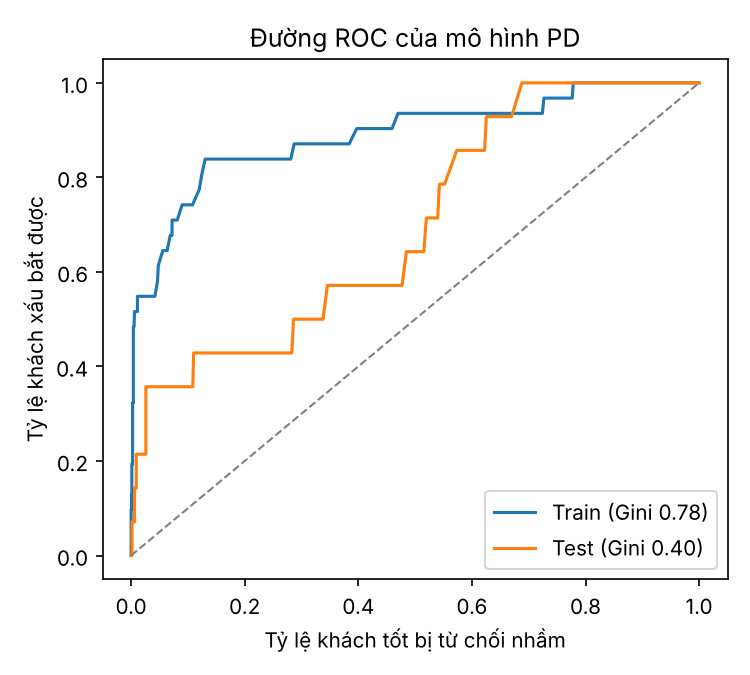

# Basel Lab: tôi tự xây và tự kiểm định một mô hình PD

Ngô Thị Ánh Hồng · Tài chính doanh nghiệp, NEU · 11/2026

Tôi làm project này vì muốn hiểu một mô hình xác suất vỡ nợ (PD) trong ngân hàng đi từ dữ liệu thô đến con số vốn như thế nào, thay vì chỉ học công thức Basel trên giấy. Tôi làm lần lượt bằng SQL, Excel và Python trên một cơ sở dữ liệu ngân hàng mô phỏng, sau đó chạy lại cùng quy trình trên dữ liệu thật German Credit.

Kết quả tôi thấy đáng nói nhất: mô hình PD đạt Gini 0,78 trên tập train nhưng chỉ 0,40 trên tập test. Phần lớn thời gian cuối project tôi dành để tìm hiểu xem đó là overfitting hay chỉ là do tập test có quá ít khoản vỡ nợ.

*Tình trạng (16/11/2026): toàn bộ code đã chạy được từ đầu đến cuối. Tôi đang thử binning lại một số biến và viết thêm phần kiểm định out-of-time.*

## Dữ liệu

Dữ liệu chính là một ngân hàng giả lập (`src/gen_data.py`) gồm khoảng 2.280 khoản vay bán lẻ, SME và doanh nghiệp, theo dõi dpd hằng tháng từ 11/2025 đến 10/2026. Dữ liệu có cài sẵn lỗi để kiểm tra quy trình làm sạch. Đây không phải dữ liệu ngân hàng thật.

Để kiểm tra trên dữ liệu thực tế, tôi dùng bộ [German Credit](https://archive.ics.uci.edu/dataset/144/statlog+german+credit+data) (UCI): 1.000 khoản vay tiêu dùng, 300 khoản vỡ nợ.

## Tôi đã làm gì

**Kiểm tra dữ liệu bằng SQL** (`sql/01_kiem_tra_du_lieu.sql`). Trước khi làm gì khác, tôi tìm lỗi: 6 khách hàng trùng mã, 3 khoản vay không có khách hàng, 4 khoản dư nợ âm, 5 khoản có tài sản bảo đảm nhưng thiếu giá trị. Khách hàng trùng làm phép JOIN đếm hai lần dư nợ, nên tôi khử trùng bằng CTE trước rồi mới tổng hợp.

**Roll rate và staging** (`sql/02_roll_rate_va_staging.sql`). Dùng window function (`LAG`, `LEAD`, `ROW_NUMBER`) để dựng ma trận chuyển nhóm nợ. Mỗi tháng khoảng 0,7–1,3% khoản nhóm 1 rơi xuống nhóm 2, và 22–42% khoản nhóm 2 tự khỏi. Khi đổi quy tắc staging IFRS 9 sang "nhìn lại dpd 3 tháng", 20 khoản đang ở Stage 1 bị chuyển sang Stage 2. Câu đối chiếu cuối cùng phát hiện 4 khoản dư nợ âm ở bảng `loans` lại dương ở bảng snapshot.

**Tính vốn trên Excel** (`excel/rwa_car_phuong_phap_chuan.xlsx`). Tôi tính RWA theo phương pháp chuẩn (CCF, LTV, tài sản bảo đảm bằng tiền gửi) và CAR. Ngân hàng giả lập có CET1 7,48%, Tier 1 8,42%, CAR 10,29%: đạt mức tối thiểu nhưng thủng bộ đệm bảo toàn vốn 2,5%. Sheet `KiemSoat` có 8 phép đối chiếu, tất cả ra OK.

**Mô hình PD** (`src/b4_chuan_bi_du_lieu.py`, `src/b5_mo_hinh_pd.py`). Mốc quan sát là 30/04/2026: biến chỉ lấy dữ liệu đến ngày đó, nhãn default là dpd > 90 trong 6 tháng sau. Mẫu có 2.225 khoản vay, 45 khoản default (2,0%). Tôi chia nhóm biến, mã hóa WoE, giữ biến có IV ≥ 0,02, rồi loại dần biến có hệ số sai dấu.

Lần chạy đầu có một biến cho AUC = 1,000. Hóa ra biến đó lấy dpd *sau* mốc quan sát, tức là mô hình đã nhìn trước kết quả. Từ đó tôi luôn kiểm tra mốc thời gian của từng biến trước khi đưa vào mô hình.

Áp mô hình lên danh mục tại 31/10/2026, ECL (PD 12 tháng × LGD × EAD) ra khoảng 248 tỷ đồng, bằng 1,29% EAD.

**IRB so với phương pháp chuẩn** (`src/b6_irb_rwa.py`). Đưa PD vào công thức IRB của Basel (CRE31), RWA bằng 85,4% phương pháp chuẩn, chưa chạm output floor 72,5%. Riêng thấu chi SME lại tốn vốn hơn (135% SA) vì PD của nhóm này cao.

**Kiểm định** (`src/b7_kiem_dinh.py`). Phần này tôi thấy giống công việc Model Risk nhất:

| | Dữ liệu mô phỏng | German Credit |
|---|---|---|
| Gini train / test | 0,779 / 0,399 | 0,633 / 0,599 |
| KS test | 0,331 | 0,503 |
| Số khoản vỡ nợ trong test | 14 | 90 |
| Khoảng tin cậy 95% của AUC test | 0,566 – 0,829 | 0,745 – 0,852 |



Với chỉ 14 khoản vỡ nợ, khoảng tin cậy của AUC rộng đến mức chưa thể kết luận mô hình bị overfitting. Trên German Credit, nơi có 90 khoản vỡ nợ, train và test gần nhau hơn hẳn, và PD dự báo bình quân (29,7%) gần đúng tỷ lệ vỡ nợ thực tế (30,0%). Ở bộ này tôi cũng bỏ hai biến giới tính/hôn nhân và lao động nước ngoài, vì không nên dùng làm căn cứ xét duyệt cho vay.

Kiểm định nhị thức theo 5 hạng cho thấy hạng 3 không đạt (p = 0,02): mô hình đang đánh giá thấp rủi ro của nhóm khách hàng ở giữa thang điểm. PSI giữa tập phát triển và danh mục hiện tại là 0,005, phân phối điểm ổn định. Chi tiết nằm trong `outputs/tai_lieu_ky_thuat_pd.md`.

## Những gì tôi chưa làm được

- PD chỉ dự báo cho 6 tháng vì dữ liệu chỉ có 12 tháng; tôi quy đổi sang 12 tháng bằng giả định rủi ro đều.
- LGD trong phần ECL và IRB là số giả định theo loại tài sản bảo đảm, không ước lượng từ dữ liệu thu hồi nợ.
- Chưa kiểm định out-of-time, vì dữ liệu quá ngắn để tách theo thời gian.
- Hạng 3 chưa đạt kiểm định nhị thức; tôi đang xem lại cách chia nhóm biến `dpd_hien_tai`.

Nếu làm lại, tôi sẽ tìm một bộ dữ liệu dài hơn (ví dụ Lending Club) để có đủ khoản vỡ nợ và tách được tập out-of-time.

## Chạy lại

```
pip install -r requirements.txt
python src/chay_tat_ca.py                              # Python: bước 4 -> 7 và German Credit
python src/run_sql.py sql/01_kiem_tra_du_lieu.sql      # SQL
python src/run_sql.py sql/02_roll_rate_va_staging.sql
```

```
├── data/        bank.db, các file csv, german_credit.csv
├── sql/         kiểm tra dữ liệu, roll rate, staging
├── excel/       RWA và CAR theo phương pháp chuẩn
├── src/         Python: chuẩn bị dữ liệu, mô hình PD, IRB, kiểm định
└── outputs/     biểu đồ, bảng IV, tài liệu kỹ thuật mô hình
```
